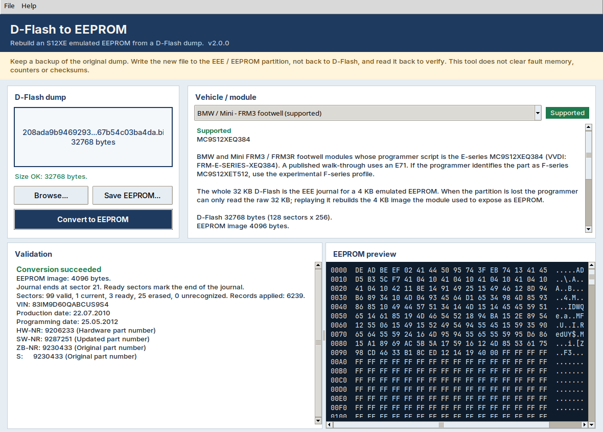
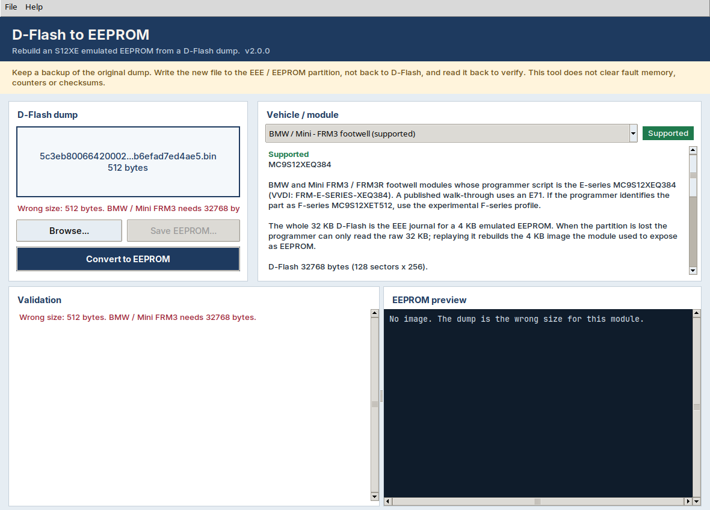
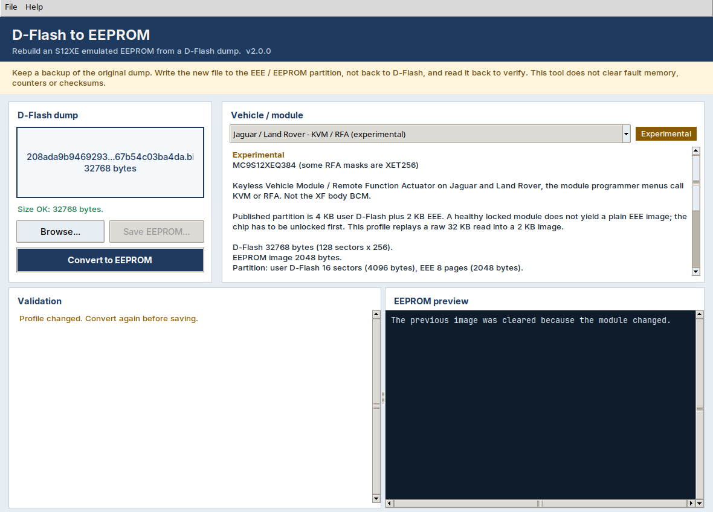

# D-Flash to EEPROM

Rebuild the emulated EEPROM (EEE) of a Freescale/NXP S12XE microcontroller from a raw D-Flash dump. The original tool, by Ben van Leeuwen Autotechniek, repaired BMW FRM3 modules whose MC9S12XEQ384 had lost its EEPROM partition. This version keeps that decoder, turns it into a library the command line, desktop window and web upload all share, and adds module profiles for the other S12XE layouts that public repair notes actually describe.

BSD-3-Clause. Copyright 2017-2018 Ben van Leeuwen Autotechniek. Copyright 2026 Jose.

## Safety

Keep a backup of the original dump before you change the partition. Writing the partition erases D-Flash.

Program the converted file into the **EEE / EEPROM** area, not back into D-Flash, and read it back to verify. A wrong profile, or a dump taken after the D-Flash was already overwritten, produces a file that looks like an EEPROM and is still wrong.

This tool does not clear fault memory, short-circuit counters, mileage or checksums. After an FRM3 is back in the car, clear the fault memory. Reset short-circuit counters separately when the module needs that.

Profiles marked **Experimental** are not confirmed memory maps. Do not program one until you have compared it with a known-good module of the same hardware. **Not supported** entries are there so the wrong module is refused instead of converted.

## Modules

Every convertible profile uses the S12XE hardware journal from Freescale AN3490: 256-byte sectors, a two-word header, 63 records of a 16-bit address and a 16-bit data word. The address tags in real FRM dumps are `0xFACF` for a data sector, `0xB800` for a programmed record and `0xF800` for an empty record. D-Flash on the MC9S12XE series is 32 KB (128 sectors). EEE size is the partition, not a second copy of that 32 KB.

| Profile | Status | MCU | Dump | EEPROM to write | Partition |
| --- | --- | --- | --- | --- | --- |
| `bmw_frm3` | Supported | MC9S12XEQ384 | 32 KB | 4 KB | DFPART 0, ERPART 16 |
| `jlr_xf_bcm` | Supported | MC9S12XE, XET256 reported on XF BCM/BCMB | 32 KB | 2 KB | DFPART 0, ERPART 8 |
| `bmw_frm_f_xet512` | Experimental | Programmer script name MC9S12XET512 | 32 KB assumed | 4 KB assumed | Not confirmed. Numbers are copied from FRM3. No FRM3 field map. |
| `jlr_kvm` | Experimental | MC9S12XEQ384, some RFA masks are XET256 | 32 KB raw read | 2 KB | Published as 4 KB user D-Flash and 2 KB EEE. Sector order inside the raw image is not confirmed. Often encrypted. |
| `bmw_cas4` | Not supported | XDP512 (v1) or XEP100 (CAS4+) | — | — | CAS4+ is 32 KB user D-Flash and no EEE. This journal does not apply. |

### Sources

Supported means each of these was checked, not guessed.

**BMW / Mini FRM3.** AN3490 describes the family EEE (32 KB D-Flash on the S12XEP100, 256-byte sectors, 63 records, the DFPART/ERPART rule). The UPA-S footwell manual for the MC9S12XEQ384 shows D-Flash 32 KB, EEE up to 4 KB, and the partition EEE 16 pages / D-Flash user 0. Xhorse's MC9S12XE note uses the E-chassis FRM as the "whole D-Flash given to EEE, which yields 4 KB" example, and says a lost partition must be read as 32 KB and converted. The VVDI Prog FRM walk-through reads EEE 0 / D-Flash 128 sectors and writes EEE 16 / D-Flash 0. The `ci/` sample pairs are the original decoder's regression set: 32 KB in, 4 KB out, including the VIN and part-number strings. Mini FRM3 uses the same MCU and the same procedure.

**Jaguar XF BCM / BCMB.** Repair notes on Jaguar Forum identify the failed memory as the emulated EEPROM, point at this project's decoder, and say the XF uses 2 KB rather than the BMW 4 KB, with the partition 2048 bytes EEPROM and 0 D-Flash. A 2013 XF thread names the MC9S12XET256 and the write-back partition 8 x 256 EEPROM, D-Flash 0. The rear BCMB thread names MC9S12XET256 on CX23-14D628 and the same 2 KB / 0 D-Flash split for the later DX23 units. XET256 and XEQ384 are both MC9S12XE parts; Xhorse states that the series D-Flash is 32 KB. ERPART 8 and DFPART 0 is a legal AN3490 partition and is 2 KB of EEE. That 2 KB is the top of the 4 KB buffer RAM at 0x13_F000-0x13_FFFF: AN3490 section 4.2 stores the buffer word address in each record, and AN3743 Figure 6 puts ERPART at the top of the buffer, so ERPART 8 is bytes 0x800-0xFFF of a 4 KB replay (global 0x13_F800-0x13_FFFF). A journal whose addresses are only in that top half is this 2 KB image. Addresses that also use the bottom half need the 4 KB profile, and the window then says so instead of writing an empty file. VIN offsets from the FRM3 are not applied here. They were only checked on the FRM samples.

**Experimental and refused.** VVDI lists a separate F-series FRM script as MC9S12XET512 and, in the same note, also associates mask 2M25J with 9S12XEQ384. No source used here gives that script its own sizes, so the profile is experimental and does not decode FRM3 fields. Xhorse and the CG100 KVM procedure both say Land Rover / Jaguar KVM is 4 KB D-Flash plus 2 KB EEPROM, and that the chip (security byte FC) has to be unlocked first. They do not say which end of a raw 32 KB file holds the 16 user sectors, so the KVM profile scans all 128 sectors, treats non-EEE sectors as warnings, and stays experimental. CAS4 version 1 is an MC9S12XDP512 with a real EEPROM. CAS4+ is an MC9S12XEP100 partitioned as 32 KB user D-Flash and no EEE. The profile refuses to convert either.

Links:

- AN3490, https://www.nxp.com/docs/en/application-note/AN3490.pdf
- UPA-S MC9S12XEQ384 footwell manual, https://www.ecupinout.com/public/STD_FRM_MCU-9S12XEQ384_OSC8_4.75v_ConnStd4.pdf
- Xhorse MC9S12XE partition notes, https://www.xhorsevvdi.com/service/tips-and-info-about-mc9s12xe-chip.html
- VVDI Prog FRM E-series / F-series scripts, http://blog.vvdishop.com/repair-bmw-frm3-xeq384-with-vvdi-prog/
- Jaguar XF BCM repair using this decoder, https://www.jaginfo.org/threads/bcm-repair.117049/page-7
- Jaguar XF 2 KB partition, https://www.jaginfo.org/threads/problem-with-jaguar-xf-key-not-found.117470/page-4
- Jaguar XF BCMB MC9S12XET256, https://www.jaginfo.org/threads/bcmb-dump-rewrite.118137/
- CG100 KVM partition DFLASH 4K / EEPROM 2K, https://blog.uobdii.com/jaguar-land-rover-kvm-reset-cg100-can-read-write-9s12xeq384/

## Desktop

Requires Python 3.10+ with Tk (the `python3-tk` package on Debian/Ubuntu). Drag-and-drop also needs `tkinterdnd2`; Browse works without it.

```bash
python3 -m pip install -r requirements.txt
python3 gui.py
```

Open a D-Flash dump with Browse or by dropping the file on the window. Pick the module. Convert. Read the validation panel: wrong size, no `0xFACF` sectors, bad record codes and addresses past the EEE are called out there. The hex view is the file you are about to program. Save writes that file only. If the conversion reported errors, Save asks before it writes.

You can also start with a file already chosen:

```bash
python3 gui.py dump.bin
```







### Windows executable

`build.cmd` installs PyInstaller and tkinterdnd2, then builds `dist\dflash_to_eee.exe` from `dflash_to_eee.spec`. The GitHub Actions workflow `windows-exe` runs the tests on Windows and uploads that executable as a build artifact. A version tag publishes the same exe on the Releases page; see Releasing. Drop-in profiles can be placed in a `profiles` folder next to the exe.

## Releasing

Pushing a version tag runs `.github/workflows/release.yml`. That workflow checks out the tag, runs the tests, builds `dflash_to_eee.exe` with `dflash_to_eee.spec`, and publishes a GitHub Release for the tag. The release gets the exe, `SHA256SUMS.txt` (SHA-256, two spaces, then the file name), and the notes GitHub generates from commits since the previous tag. It uses the built-in `GITHUB_TOKEN` with `contents: write`. No other secret is required.

From an up-to-date `master`:

```bash
git checkout master
git pull origin master
git tag -a v1.0.0 -m "v1.0.0"
git push origin v1.0.0
```

The release shows up on the repository Releases page when the workflow finishes. On Windows, check the download with `Get-FileHash .\dflash_to_eee.exe -Algorithm SHA256` and compare it to `SHA256SUMS.txt` (the file stores the hash in lowercase).

Creating the release in the GitHub UI does the same work. Open **Releases → Draft a new release**, choose or create the tag `v1.0.0` on `master`, generate the notes if you want them filled in now, and publish. Publishing creates the tag, which starts the workflow and attaches the exe and checksum to that release. A draft stays a draft; the files are added when the build finishes, and you publish it yourself.

Tags must look like `v1.0.0`. A suffix such as `v1.0.0-rc.1` is published as a pre-release. To rebuild a tag that already exists, open **Actions → Release → Run workflow** and enter that tag. The new exe and checksum replace the previous files. The notes are left as they are.

## Command line

The two-argument form is the original FRM3 command. Output bytes and log text match the samples in `ci/`.

```bash
python3 dflash_to_eee.py dflash.bin eeprom.bin
python3 dflash_to_eee.py --list-profiles
python3 dflash_to_eee.py --profile jlr_xf_bcm dflash.bin eeprom.bin
python3 dflash_to_eee.py --profile bmw_frm3 --strict dflash.bin eeprom.bin
```

`--strict` exits with status 2 when the length is not the profile's D-Flash size or the journal looks corrupt. The two-argument form does not: a longer file is still replayed from its first 32 KB, which is what the original script did.

From Python:

```python
from dflash_eee import convert_bytes, get_profile

result = convert_bytes(open("dflash.bin", "rb").read(), get_profile("bmw_frm3"))
if result.ok:
    open("eeprom.bin", "wb").write(result.image)
```

## How the replay works

D-Flash is used as a circular journal. Each 256-byte sector holds up to 63 EEPROM updates. A word starts erased (`0xFFFF`) and changes when a later record names it. Sector order matters. A header of `FFFFFFFE` is a sector prepared as the next one to write. A sector that still has empty record slots is the current one and should sit just before those prepared sectors. If neither marker is trustworthy, the longest run of erased sectors is treated as the prepared gap.

That is the 2017 decoder, checked against the dumps in `ci/input`. AN3490 is what makes the numbers a profile instead of constants: sector size, 63 records, the ready-sector pool, and the DFPART/ERPART split. The tag values themselves (`0xFACF`, `0xB800`, `0xF800`) are the ones in those dumps. AN3490 describes the header and the address/data record; it does not print those tags.

An empty record marks the sector as the current one but does not stop the scan of that sector. Later records in the same sector are still applied. The sample set depends on this, so it is intentional.

## Adding a module

Built-in profiles live in `dflash_eee/profiles.py`. A shop can also drop a JSON file into `profiles/` next to the working directory, or next to the frozen exe. A JSON file is always loaded as experimental, even if it says supported. An id that collides with a built-in profile is rejected.

```json
{
  "id": "shop_module",
  "title": "Shop module",
  "manufacturer": "BMW",
  "status": "experimental",
  "mcu": "MC9S12XEQ384",
  "vehicles": "Which cars, and how you identified the MCU.",
  "dflash_size": 32768,
  "eee_size": 2048,
  "dfpart_sectors": 0,
  "erpart_pages": 8,
  "summary": "What the dump is.",
  "write_notes": "What to program, and what not to.",
  "assumptions": "What you have not verified.",
  "sources": ["Where the sizes came from."]
}
```

`eee_size` must equal `erpart_pages * 256` when you mark the partition confirmed. The AN3490 rule is checked: `(128 - DFPART) / ERPART` at least 8, and at least 12 EEE sectors when ERPART is 1. Do not add field offsets unless you have measured them on dumps from that module. The FRM3 VIN and part-number offsets are not a generic map.

## Tests

```bash
python3 -m pytest -q
```

`ci/input/dflash` is replayed with the original two-argument command. Where `ci/input/eee` has a paired image, the bytes must match. Log lines (VIN, dates, part numbers, warnings, the short-file exception) must match `ci/input/logs`. Synthetic journals cover overwrite order, the empty-record quirk, unknown commands, a short file, an unrecognized layout, and the 2 KB profile.

`ci/run_ci.sh` runs that same suite.

## Web upload

`webserver/` is the original upload form. It now calls `dflash_to_eee.py --profile ...` so it uses the same library. The form still expects a 32768-byte file, which is the D-Flash size of every profile this page can convert. The server must have Python 3 on `PATH`.

## License

BSD-3-Clause. See `LICENSE`. Redistributions of source or binaries must keep the copyright notice, the conditions and the disclaimer. The names of the copyright holders may not be used to endorse a derived product without permission.
