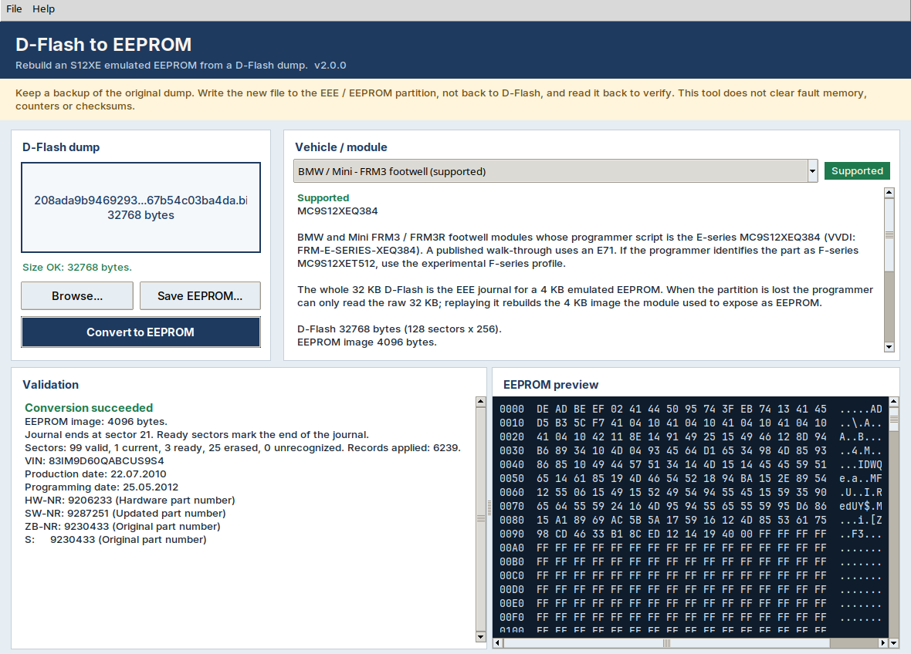
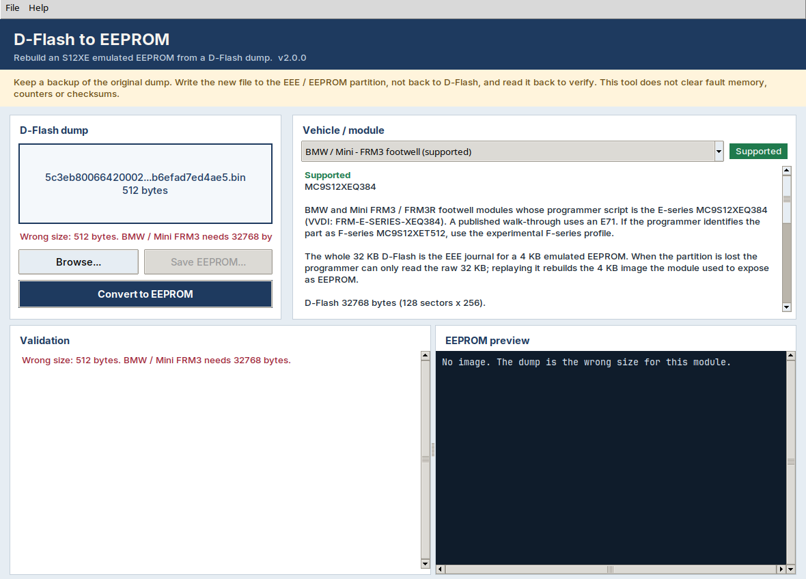
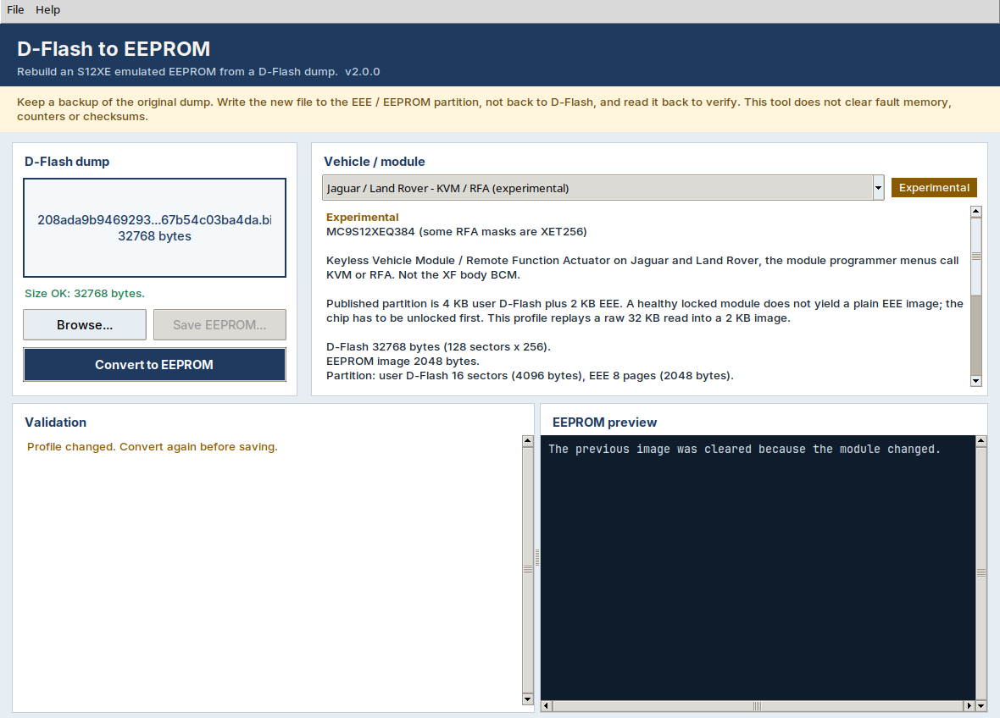

# D-Flash a EEPROM

[English](README.md)

Reconstruye la EEPROM emulada (EEE) de un microcontrolador Freescale/NXP S12XE a partir de un volcado crudo de D-Flash. La herramienta original, de Ben van Leeuwen Autotechniek, reparaba módulos FRM3 de BMW cuyo MC9S12XEQ384 había perdido la partición de la EEPROM. Esta versión conserva ese decodificador, lo vuelve una biblioteca que comparten la línea de comandos, la ventana de escritorio y la carga web, y agrega perfiles de módulo para los otros layouts S12XE que las notas públicas de reparación sí describen.

BSD-3-Clause. Copyright 2017-2018 Ben van Leeuwen Autotechniek. Copyright 2026 Jose.

## Seguridad

Conserve un respaldo del volcado original antes de tocar la partición. Grabar la partición borra el D-Flash.

Programe el archivo convertido en el área **EEE / EEPROM**, no de vuelta en el D-Flash, y vuelva a leerlo para verificar. Un perfil equivocado, o un volcado tomado después de que el D-Flash ya fue sobrescrito, produce un archivo que parece EEPROM y aun así está mal.

Esta herramienta no borra la memoria de fallas, los contadores de cortocircuito, el kilometraje ni los checksums. Cuando el FRM3 ya está de nuevo en el carro, borre la memoria de fallas. Los contadores de cortocircuito se resetean aparte, cuando el módulo lo pide.

Los perfiles marcados **Experimental** no son mapas de memoria confirmados. No programe uno hasta compararlo con un módulo conocido bueno del mismo hardware. Las entradas **No soportado** están para que el módulo equivocado se rechace en lugar de convertirse.

## Módulos

Todo perfil que se puede convertir usa la bitácora de hardware S12XE de Freescale AN3490: sectores de 256 bytes, un encabezado de dos palabras, 63 registros de una dirección de 16 bits y una palabra de datos de 16 bits. Las etiquetas de dirección en volcados reales de FRM son `0xFACF` para un sector de datos, `0xB800` para un registro programado y `0xF800` para un registro vacío. El D-Flash de la serie MC9S12XE es de 32 KB (128 sectores). El tamaño de la EEE es el de la partición, no una segunda copia de esos 32 KB.

| Perfil | Estado | MCU | Volcado | EEPROM a grabar | Partición |
| --- | --- | --- | --- | --- | --- |
| `bmw_frm3` | Soportado | MC9S12XEQ384 | 32 KB | 4 KB | DFPART 0, ERPART 16 |
| `jlr_xf_bcm` | Soportado | MC9S12XE, XET256 reportado en el BCM/BCMB del XF | 32 KB | 2 KB | DFPART 0, ERPART 8 |
| `bmw_frm_f_xet512` | Experimental | Nombre de script del programador: MC9S12XET512 | 32 KB supuestos | 4 KB supuestos | No confirmado. Los números están copiados del FRM3. No hay mapa de campos del FRM3. |
| `jlr_kvm` | Experimental | MC9S12XEQ384, algunas máscaras RFA son XET256 | Lectura cruda de 32 KB | 2 KB | Publicado como 4 KB de D-Flash de usuario y 2 KB de EEE. El orden de los sectores dentro de la imagen cruda no está confirmado. A menudo va cifrado. |
| `bmw_cas4` | No soportado | XDP512 (v1) o XEP100 (CAS4+) | — | — | El CAS4+ es 32 KB de D-Flash de usuario y sin EEE. Esta bitácora no aplica. |

### Fuentes

Soportado quiere decir que cada una de estas se revisó, no que se adivinó.

**BMW / Mini FRM3.** AN3490 describe la EEE de la familia (D-Flash de 32 KB en el S12XEP100, sectores de 256 bytes, 63 registros, la regla DFPART/ERPART). El manual UPA-S del módulo de piso para el MC9S12XEQ384 muestra D-Flash de 32 KB, EEE de hasta 4 KB y la partición EEE 16 páginas / D-Flash de usuario 0. La nota de Xhorse sobre el MC9S12XE usa el FRM de chasis E como el ejemplo de "todo el D-Flash entregado a la EEE, que da 4 KB", y dice que una partición perdida se lee como 32 KB y se convierte. El procedimiento VVDI Prog del FRM lee EEE 0 / D-Flash 128 sectores y escribe EEE 16 / D-Flash 0. Los pares de `ci/` son el juego de regresión del decodificador original: 32 KB entran, 4 KB salen, con el VIN y los números de parte. El FRM3 de Mini usa el mismo MCU y el mismo procedimiento.

**Jaguar XF BCM / BCMB.** Las notas de reparación en Jaguar Forum identifican la memoria fallada como la EEPROM emulada, apuntan al decodificador de este proyecto y dicen que el XF usa 2 KB y no los 4 KB de BMW, con la partición de 2048 bytes de EEPROM y 0 de D-Flash. Un hilo de un XF 2013 nombra el MC9S12XET256 y la partición de escritura 8 x 256 de EEPROM, D-Flash 0. El hilo del BCMB trasero nombra el MC9S12XET256 en el CX23-14D628 y la misma división de 2 KB / 0 de D-Flash para las unidades DX23 posteriores. El XET256 y el XEQ384 son ambos piezas MC9S12XE; Xhorse indica que el D-Flash de la serie es de 32 KB. ERPART 8 y DFPART 0 es una partición legal según AN3490 y son 2 KB de EEE. Los desplazamientos del VIN del FRM3 no se aplican aquí. Solo se comprobaron en las muestras del FRM.

**Experimental y rechazado.** VVDI lista un script aparte de FRM serie F como MC9S12XET512 y, en la misma nota, también asocia la máscara 2M25J con 9S12XEQ384. Ninguna fuente usada aquí le da a ese script sus propios tamaños, así que el perfil es experimental y no decodifica los campos del FRM3. Xhorse y el procedimiento CG100 del KVM dicen que el KVM de Land Rover / Jaguar es 4 KB de D-Flash más 2 KB de EEPROM, y que el chip (byte de seguridad FC) hay que desbloquearlo primero. No dicen en qué extremo de un archivo crudo de 32 KB están los 16 sectores de usuario, así que el perfil KVM recorre los 128 sectores, trata los sectores que no son EEE como advertencias y se queda experimental. El CAS4 versión 1 es un MC9S12XDP512 con EEPROM real. El CAS4+ es un MC9S12XEP100 particionado como 32 KB de D-Flash de usuario y sin EEE. El perfil se niega a convertir cualquiera de los dos.

Enlaces:

- AN3490, https://www.nxp.com/docs/en/application-note/AN3490.pdf
- Manual UPA-S del módulo de piso MC9S12XEQ384, https://www.ecupinout.com/public/STD_FRM_MCU-9S12XEQ384_OSC8_4.75v_ConnStd4.pdf
- Notas de partición Xhorse MC9S12XE, https://www.xhorsevvdi.com/service/tips-and-info-about-mc9s12xe-chip.html
- Scripts VVDI Prog FRM serie E / serie F, http://blog.vvdishop.com/repair-bmw-frm3-xeq384-with-vvdi-prog/
- Reparación de BCM Jaguar XF con este decodificador, https://www.jaginfo.org/threads/bcm-repair.117049/page-7
- Partición de 2 KB del Jaguar XF, https://www.jaginfo.org/threads/problem-with-jaguar-xf-key-not-found.117470/page-4
- Jaguar XF BCMB MC9S12XET256, https://www.jaginfo.org/threads/bcmb-dump-rewrite.118137/
- Partición CG100 KVM DFLASH 4K / EEPROM 2K, https://blog.uobdii.com/jaguar-land-rover-kvm-reset-cg100-can-read-write-9s12xeq384/

## Escritorio

Hace falta Python 3.10 o más nuevo con Tk (el paquete `python3-tk` en Debian/Ubuntu). Arrastrar y soltar también necesita `tkinterdnd2`; Examinar funciona sin eso.

```bash
python3 -m pip install -r requirements.txt
python3 gui.py
```

Abra un volcado D-Flash con Examinar o soltando el archivo en la ventana. Elija el módulo. Convierta. Lea el panel de validación: ahí se señalan el tamaño incorrecto, la falta de sectores `0xFACF`, los códigos de registro malos y las direcciones que se pasan de la EEE. La vista hex es el archivo que está a punto de programar. Guardar escribe solo ese archivo. Si la conversión reportó errores, Guardar pregunta antes de escribir.

También puede arrancar con un archivo ya elegido:

```bash
python3 gui.py dump.bin
```







## Comparar dos volcados

Sirve cuando hay que revisar dos binarios: la EEPROM original y el archivo que acaba de armar esta herramienta, un volcado de antes de la reparación y la lectura después de programar, o dos BCM. Comparar solo lee los archivos.

En la ventana, abra **Herramientas → Comparar archivos...**. Elija el archivo A y el archivo B con Examinar. **Última conversión** llena ese lado con la imagen EEPROM que está en la ventana principal, aunque todavía no se haya guardado. Si ya hay una conversión en pantalla, el archivo B empieza como esa imagen.

Las dos vistas hex quedan en el mismo offset. Cada fila es el offset, 16 bytes en hex y la columna ASCII. Los bytes que difieren van resaltados. Si un archivo es más largo, el lado corto muestra `--` en lo que falta. Debajo se listan los rangos contiguos de diferencias. Un clic salta a ese rango. **Diferencia anterior** y **Diferencia siguiente** (F3 y Shift+F3) hacen lo mismo. **Solo filas con diferencias** oculta las filas iguales.

El resumen da los dos tamaños, si los archivos son idénticos, cuántos bytes y rangos difieren, y el SHA-256 de cada archivo. Un archivo de unos megabytes sigue respondiendo: solo se dibujan las filas que se ven.

**Exportar texto...** escribe el resumen y el hex completo de cada rango. **Exportar CSV...** escribe el mismo resumen y luego una fila por rango. Las columnas del CSV se quedan en inglés (`offset`, `length`, `hex_a`, `hex_b`) para que una hoja de cálculo las lea siempre igual. SHA-256, offset, hex y las letras A y B se quedan así en los dos idiomas.

```bash
python3 dflash_to_eee.py compare original.bin readback.bin
python3 dflash_to_eee.py --lang es compare original.bin readback.bin --report diff.txt
python3 dflash_to_eee.py compare original.bin readback.bin --report diff.csv
```

El código de salida es 0 si son idénticos, 1 si difieren y 2 si un archivo no se puede leer o el reporte no se puede escribir. La terminal imprime el resumen y cada rango. Un rango largo muestra ahí los primeros 16 bytes; el archivo de reporte lista todos. `--report` escribe CSV cuando la ruta termina en `.csv`.

### Ejecutable de Windows

`build.cmd` instala PyInstaller y tkinterdnd2, y luego arma `dist\dflash_to_eee.exe` desde `dflash_to_eee.spec`. El workflow de GitHub Actions `windows-exe` corre las pruebas en Windows y sube ese ejecutable como artefacto. Una etiqueta de versión publica el mismo exe en la página de Releases; vea Publicar. Los perfiles sueltos se pueden dejar en una carpeta `profiles` junto al exe. Los catálogos de idioma viajan dentro del exe.

## Comprobar la descarga / Windows SmartScreen

El exe de Windows en la página de Releases no trae firma de código. La primera vez que lo abre, SmartScreen muestra "Windows protected your PC" (en un Windows en español: "Windows protegió tu PC"). Es el aviso que Windows usa para un programa sin firma bajado de internet. El ejecutable es una compilación de código abierto del workflow público de Release. Pulse **More info** (Más información) y después **Run anyway** (Ejecutar de todas formas), solo cuando el hash coincida. Si prefiere no correr el exe bajado, ármelo desde la misma etiqueta.

Baje `dflash_to_eee.exe` y `SHA256SUMS.txt` del mismo release.

PowerShell, en la carpeta donde guardó el exe:

```powershell
Get-FileHash .\dflash_to_eee.exe -Algorithm SHA256
```

`certutil` imprime el mismo hash:

```bat
certutil -hashfile dflash_to_eee.exe SHA256
```

`SHA256SUMS.txt` trae ese hash en minúsculas, dos espacios y luego `dflash_to_eee.exe`. Las notas del release imprimen el mismo hash y enlazan la etiqueta, el commit y la corrida de Actions que armó el exe. Si los hashes no coinciden, no corra el archivo.

La primera vez que arranca el programa, explica el aviso de SmartScreen, dice que la copia oficial es gratis y muestra el SHA-256 del archivo que está corriendo. Ese aviso queda en `%APPDATA%\dflash_to_eee\config.json` para no volver a mostrarlo. **Ayuda, Verificar esta copia** calcula el hash otra vez. Si el exe lo armó el workflow de publicación y se puede llegar a GitHub, baja `SHA256SUMS.txt` de esa etiqueta y dice si coincide, si no coincide, o si no pudo comprobar. La consulta se corta a los pocos segundos. Arrancar el programa no usa la red. Una copia desde el código fuente dice que está corriendo desde el código, en lugar de calcular el hash del intérprete de Python.

## Publicar

Empujar una etiqueta de versión corre `.github/workflows/release.yml`. Ese workflow hace checkout de la etiqueta, corre las pruebas, escribe la etiqueta y el commit dentro del ejecutable, arma `dflash_to_eee.exe` con `dflash_to_eee.spec` y publica un GitHub Release para esa etiqueta. El release lleva el exe, `SHA256SUMS.txt` (SHA-256, dos espacios y luego el nombre del archivo) y las notas. Las notas abren con el aviso de que el software es gratis, siguen con cómo comprobar la descarga y después las notas que GitHub genera desde los commits posteriores a la etiqueta anterior. Usa el `GITHUB_TOKEN` integrado con `contents: write`. No hace falta otro secreto.

Desde un `master` al día:

```bash
git checkout master
git pull origin master
git tag -a v1.0.0 -m "v1.0.0"
git push origin v1.0.0
```

El release aparece en la página Releases del repositorio cuando el workflow termina. En Windows, revise la descarga con `Get-FileHash .\dflash_to_eee.exe -Algorithm SHA256` y compárela con `SHA256SUMS.txt` (el archivo guarda el hash en minúsculas).

Crear el release en la interfaz de GitHub hace el mismo trabajo. Abra **Releases → Draft a new release**, elija o cree la etiqueta `v1.0.0` en `master`, genere las notas si las quiere llenas ahora, y publique. Publicar crea la etiqueta, lo que arranca el workflow y adjunta el exe y el checksum a ese release. Un borrador sigue siendo borrador; los archivos se agregan cuando termina la compilación, y usted lo publica.

Las etiquetas deben verse como `v1.0.0`. Un sufijo como `v1.0.0-rc.1` se publica como pre-release. Para reconstruir una etiqueta que ya existe, abra **Actions → Release → Run workflow** y escriba esa etiqueta. El exe y el checksum nuevos reemplazan los archivos anteriores. Las notas se reescriben igual, para que el SHA-256 de la sección de verificación coincida con el archivo recién armado.

## Idioma

La primera vez que se abre la ventana, sigue el idioma del sistema. Un locale en español (`es`, `es_MX`, `es_ES` y el resto) abre en español. El menú **Language / Idioma** cambia entre English y Español y recuerda la elección. La ventana se actualiza en el momento. El archivo es `%APPDATA%\dflash_to_eee\config.json` en Windows y `~/.config/dflash_to_eee/config.json` en los demás sistemas. El aviso de la primera corrida usa ese mismo archivo.

En la línea de comandos, `--lang es` o `--lang en` elige el idioma de esa corrida. Sin esa opción, la herramienta sigue `LC_ALL`, luego `LC_MESSAGES`, luego `LANG`, luego la elección guardada del menú y al final el idioma del sistema. El comando original de dos argumentos conserva el registro en inglés de 2017 (VIN, números de parte, advertencias de la bitácora) para que siga coincidiendo con `ci/input/logs`.

```bash
python3 dflash_to_eee.py --lang es --list-profiles
```

Para agregar un idioma, vea [CONTRIBUTING.md](CONTRIBUTING.md).

## Línea de comandos

La forma de dos argumentos es el comando original del FRM3. Los bytes de salida y el texto del registro coinciden con las muestras de `ci/`.

```bash
python3 dflash_to_eee.py dflash.bin eeprom.bin
python3 dflash_to_eee.py --list-profiles
python3 dflash_to_eee.py --lang es --profile jlr_xf_bcm dflash.bin eeprom.bin
python3 dflash_to_eee.py --profile bmw_frm3 --strict dflash.bin eeprom.bin
python3 dflash_to_eee.py --lang es compare original.bin readback.bin
```

`--strict` sale con código 2 cuando el largo no es el tamaño de D-Flash del perfil o la bitácora se ve corrupta. La forma de dos argumentos no lo hace: un archivo más largo se recorre igual desde sus primeros 32 KB, que es lo que hacía el script original.

Desde Python:

```python
from dflash_eee import convert_bytes, get_profile

result = convert_bytes(open("dflash.bin", "rb").read(), get_profile("bmw_frm3"))
if result.ok:
    open("eeprom.bin", "wb").write(result.image)
```

## Cómo funciona la reproducción

El D-Flash se usa como una bitácora circular. Cada sector de 256 bytes guarda hasta 63 actualizaciones de la EEPROM. Una palabra empieza borrada (`0xFFFF`) y cambia cuando un registro posterior la nombra. El orden de los sectores importa. Un encabezado `FFFFFFFE` es un sector preparado como el siguiente a escribir. Un sector que todavía tiene huecos de registro vacíos es el actual y debe quedar justo antes de esos sectores preparados. Si ninguno de los dos marcadores es de fiar, la tanda borrada más larga se toma como el hueco preparado.

Ese es el decodificador de 2017, comprobado contra los volcados de `ci/input`. AN3490 es lo que vuelve esos números un perfil en lugar de constantes: tamaño de sector, 63 registros, el grupo de sectores preparados y la división DFPART/ERPART. Los valores de las etiquetas (`0xFACF`, `0xB800`, `0xF800`) son los de esos volcados. AN3490 describe el encabezado y el registro de dirección/datos; no imprime esas etiquetas.

Un registro vacío marca el sector como el actual, pero no detiene el recorrido de ese sector. Los registros posteriores del mismo sector se siguen aplicando. El juego de muestras depende de esto, así que es a propósito.

## Agregar un módulo

Los perfiles incluidos viven en `dflash_eee/profiles.py`. Un taller también puede dejar un archivo JSON en `profiles/` junto al directorio de trabajo, o junto al exe congelado. Un archivo JSON siempre se carga como experimental, aunque diga que está soportado. Un id que choca con un perfil incluido se rechaza.

```json
{
  "id": "shop_module",
  "title": "Shop module",
  "manufacturer": "BMW",
  "status": "experimental",
  "mcu": "MC9S12XEQ384",
  "vehicles": "Qué carros, y cómo identificó el MCU.",
  "dflash_size": 32768,
  "eee_size": 2048,
  "dfpart_sectors": 0,
  "erpart_pages": 8,
  "summary": "Qué es el volcado.",
  "write_notes": "Qué programar, y qué no.",
  "assumptions": "Qué no ha verificado.",
  "sources": ["De dónde salieron los tamaños."]
}
```

`eee_size` debe ser igual a `erpart_pages * 256` cuando marque la partición como confirmada. Se revisa la regla de AN3490: `(128 - DFPART) / ERPART` al menos 8, y al menos 12 sectores de EEE cuando ERPART es 1. No agregue desplazamientos de campos a menos que los haya medido en volcados de ese módulo. Los desplazamientos del VIN y del número de parte del FRM3 no son un mapa genérico.

El texto que usted escriba en el JSON se muestra tal cual. La herramienta no lo traduce.

## Pruebas

```bash
python3 -m pytest -q
```

`ci/input/dflash` se recorre con el comando original de dos argumentos. Donde `ci/input/eee` tiene una imagen pareja, los bytes deben coincidir. Las líneas del registro (VIN, fechas, números de parte, advertencias, la excepción de archivo corto) deben coincidir con `ci/input/logs`. Las bitácoras sintéticas cubren el orden de sobrescritura, la rareza del registro vacío, comandos desconocidos, un archivo corto, un layout no reconocido y el perfil de 2 KB.

`ci/run_ci.sh` corre ese mismo juego.

## Carga web

`webserver/` es el formulario de carga original. Ahora llama a `dflash_to_eee.py --profile ...` para usar la misma biblioteca. El formulario sigue esperando un archivo de 32768 bytes, que es el tamaño de D-Flash de todos los perfiles que esta página puede convertir. El servidor debe tener Python 3 en el `PATH`. El formulario en sí sigue en inglés.

## Licencia

BSD-3-Clause. Vea `LICENSE`. Las redistribuciones del código o de los binarios deben conservar el aviso de copyright, las condiciones y el descargo. Los nombres de los titulares del copyright no se pueden usar para respaldar un producto derivado sin permiso.
